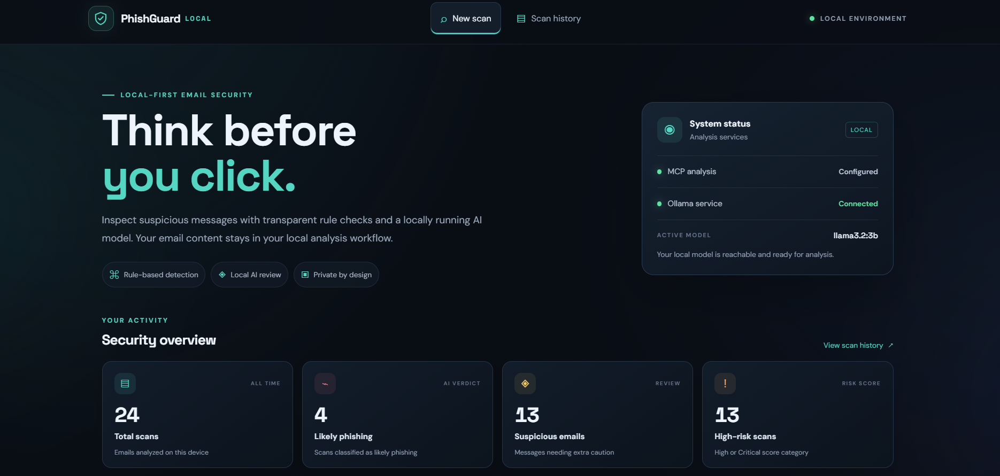
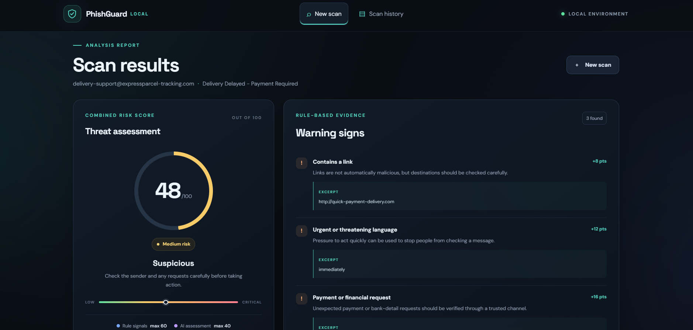
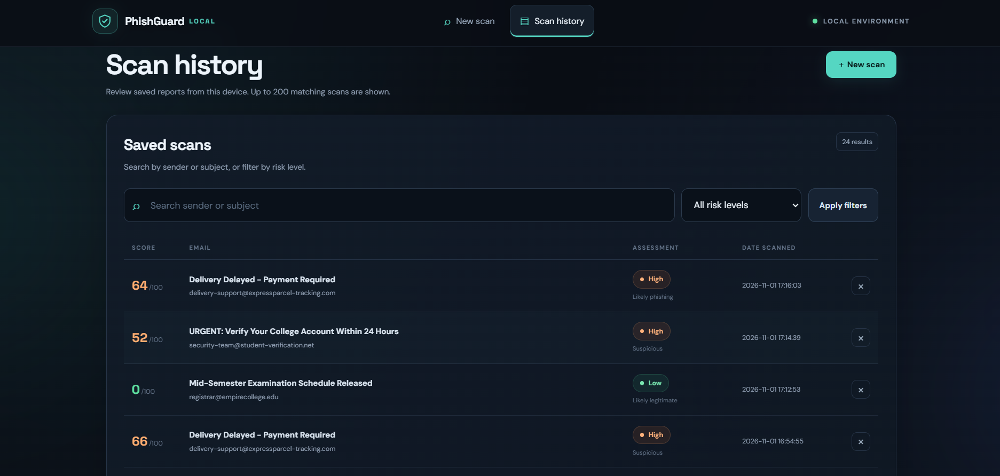
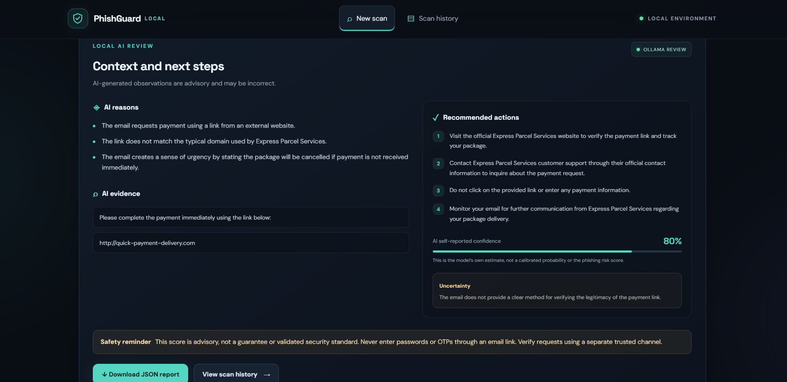
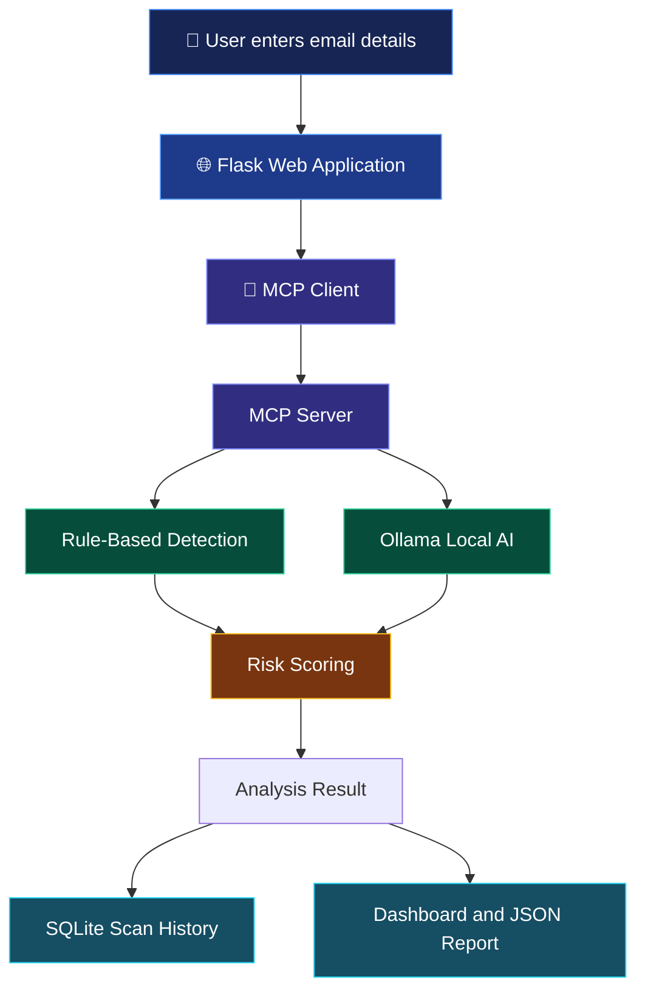

<div align="center">

# 🛡️ PhishGuardLOCAL


**Detect suspicious emails. Understand the warning signs. Stay safer online.**

A free, local-first phishing email detection system built with Python, Flask, SQLite, Ollama, and the Model Context Protocol (MCP).

Analyze email senders, subjects, and message content using transparent security rules and optional local AI — without requiring a paid AI API key.

<br>


<br>

**🔒 Local-First &nbsp; • &nbsp; 🤖 AI-Assisted &nbsp; • &nbsp; 🧪 Tested &nbsp; • &nbsp; 💸 No Paid AI API Required**

</div>

---

## 📑 Table of Contents

- [📸 Screenshots](#-screenshots)
- [✨ Overview](#-overview)
- [🚀 Features](#-features)
- [🧰 Technology Stack](#-technology-stack)
- [⚙️ Requirements](#️-requirements)
- [📥 Installation](#-installation)
- [🤖 Local AI Setup](#-local-ai-setup-with-ollama)
- [🔌 MCP Architecture](#-mcp-architecture)
- [▶️ Running the Application](#️-running-the-application)
- [🧪 Running Tests](#-running-tests)
- [📊 Risk Scoring System](#-risk-scoring-system)
- [🔍 Rule-Based Detection](#-rule-based-detection)
- [🗂️ Project Structure](#️-project-structure)
- [🔐 Safety and Limitations](#-safety-and-limitations)
- [🛠️ Troubleshooting](#️-troubleshooting)
- [📌 GitHub Delivery Checklist](#-github-delivery-checklist)

---

## 📸 Screenshots


### 🏠 1. Main Dashboard

The main interface where users enter an email sender, subject, and message body for analysis.

<p align="center">
  
</p>

### 🔎 2. Email Analysis Results

Display the detected risk level, risk score, suspicious indicators, AI assessment, and recommended safety actions.

<p align="center">
  
</p>

### 📚 3. Scan History

Show previously analyzed emails, with the available search, risk filtering, detail-view, and deletion features.

<p align="center">
  
</p>

### 🧠 4. AI-Assisted Detection

Show how the application presents the AI assessment alongside rule-based findings.

<p align="center">
  
</p>


---

## ✨ Overview

Phishing emails are designed to trick users into revealing confidential information, clicking unsafe links, or making unauthorized payments. They often imitate legitimate messages from banks, educational institutions, delivery services, and other organizations.

**PhishGuardLOCAL** provides a web-based solution for examining potentially suspicious emails.

Users enter the sender address, subject, and email body. The system evaluates the message using a rule-based detection engine and, when available, a locally running language model through Ollama. It combines the results into an advisory risk score and displays a classification with explanations.

The application also includes an MCP-based tool integration, local scan history, and downloadable JSON reports.

### 🎯 Project Objectives

- Identify common warning signs associated with phishing emails.
- Explain why an email may be suspicious instead of displaying only a classification.
- Combine transparent rules with optional AI-assisted contextual analysis.
- Keep scan history in a local SQLite database.
- Reduce reliance on paid external AI services.
- Demonstrate how Python, Flask, local AI, and MCP can work together in a cybersecurity project.

> **Important:** PhishGuardLOCAL is an educational and awareness tool. It does not guarantee that an email is safe or malicious.

---

## 🚀 Features

| Feature | Description |
|---|---|
| 🌙 Dark Web Dashboard | Responsive interface for entering and analyzing email content. |
| 🔍 Rule-Based Detection | Checks for suspicious links, urgency, credential requests, payment demands, and other warning signs. |
| 🤖 Local AI Analysis | Uses Ollama for contextual email assessment when the local model is available. |
| 🔌 MCP Integration | Exposes email analysis and safety guidance through local MCP tools. |
| 📊 Risk Scoring | Produces a combined advisory score from 0 to 100. |
| 🚦 Risk Classification | Categorizes results as Low, Medium, High, or Critical. |
| 🧾 Explainable Results | Presents findings and explanations to help users understand the assessment. |
| 🗃️ Scan History | Stores previous analyses in a local SQLite database. |
| 🔎 History Search | Supports searching and filtering saved scans. |
| 🗑️ History Management | Supports viewing details, deleting records, and clearing history with confirmation. |
| 📥 JSON Reports | Allows users to download scan reports in JSON format. |
| 🧪 Automated Tests | Tests detection rules, scoring boundaries, form validation, and mocked AI responses. |
| 💸 No Paid AI API Required | Uses a local language model rather than requiring a paid external AI API. |

---

## 🧰 Technology Stack

<table>
<tr>
<td width="50%">

### 🐍 Backend
- Python 3.11+
- Flask
- SQLite
- Python testing tools

</td>
<td width="50%">

### 🎨 Frontend
- HTML
- CSS
- JavaScript
- Responsive dark dashboard

</td>
</tr>
<tr>
<td width="50%">

### 🧠 AI & Detection
- Ollama
- `llama3.2:3b`
- Rule-based analysis
- Structured JSON AI output

</td>
<td width="50%">

### 🔌 Integration
- Model Context Protocol (MCP)
- MCP server and client
- Local subprocess communication over stdio
- JSON report export

</td>
</tr>
</table>

---

## ⚙️ Requirements

Before installation, make sure you have:

- **Python 3.11 or newer**
- **pip**, for installing Python packages
- **Ollama**, if you want to use local AI analysis
- Sufficient disk space and compatible hardware for the selected language model
- Internet access to install dependencies and download the model

Ollama is optional. The application can still perform rule-based analysis if the local AI model is unavailable.

Once dependencies and the model have been downloaded, the application is designed to perform scans locally. The local AI analysis depends on Ollama being available.

---

## 📥 Installation

### Step 1 — Open the project folder

Open Command Prompt or PowerShell and navigate to your project directory.

```powershell
cd path\to\ai-phishing-email-detector
```

Replace the example path with the actual location of your project.

### Step 2 — Create a virtual environment

```powershell
py -m venv .venv
```

### Step 3 — Activate the environment

```powershell
.\.venv\Scripts\Activate.ps1
```

If you are using Command Prompt instead of PowerShell, run:

```bat
.venv\Scripts\activate.bat
```

### Step 4 — Install dependencies

```powershell
python -m pip install --upgrade pip
pip install -r requirements.txt
```

Wait until the required packages have finished installing.

---

## 🤖 Local AI Setup with Ollama

PhishGuardLOCAL can use a local language model to provide an additional assessment of email content.

### Step 1 — Install Ollama

Download and install Ollama from its official website:

**[Download Ollama](https://ollama.com/)**

### Step 2 — Download the model

Open a terminal and run:

```powershell
ollama pull llama3.2:3b
```

The model download may require several gigabytes of storage.

### Step 3 — Check the downloaded model

```powershell
ollama list
```

Confirm that `llama3.2:3b` appears in the model list.

### Step 4 — Verify that Ollama is running

The default local API address is:

```text
http://127.0.0.1:11434
```

Ollama must be running for the application to use its local language model.

### Step 5 — Configure the model if needed

The default model is:

```text
llama3.2:3b
```

To use another model, configure the `OLLAMA_MODEL` environment variable before starting the application.


---

## 🔌 MCP Architecture

PhishGuardLOCAL integrates the **Model Context Protocol (MCP)** to expose email analysis and safety guidance as tools.

The Flask application calls the local MCP server through a client that communicates with the server over standard input/output (stdio).

### 🏗️ Request Flow



### 🧩 MCP Tools

The file `mcp_server.py` exposes two tools:

**1. `analyze_email`**

Performs the email analysis workflow, including rule checks, optional Ollama assessment, and risk scoring.

**2. `get_detection_guidance`**

Provides guidance for handling suspicious emails safely.

### 🔄 How the Integration Works

1. A user submits email details through the Flask dashboard.
2. The Flask application calls the MCP client.
3. The MCP client starts the local MCP server as a subprocess and communicates with it over stdio.
4. The server runs the analysis tool and returns the result.
5. The analysis combines available rule-based and AI-assisted findings.
6. Flask stores the result in the SQLite database and displays it to the user.

The MCP server is started automatically when an email is analyzed. You do not normally need to open a separate terminal for it.

If MCP cannot start, the Flask route logs the problem and uses its fallback path. Check the terminal logs during a demonstration to confirm that the MCP call succeeded.

### 🔬 Inspect the MCP Tools

After installing the project requirements, run:

```powershell
mcp dev mcp_server.py
```

This launches the MCP development inspector when the installed MCP tooling supports the command.

---

## ▶️ Running the Application

Make sure your virtual environment is activated.

Start the application:

```powershell
python run.py
```

Open your browser and visit:

### 🌐 [http://127.0.0.1:5000](http://127.0.0.1:5000)

Keep the terminal running while you use the application.

### ❤️ Check Application Health

Visit:

```text
http://127.0.0.1:5000/health
```

Use this endpoint to check the application's health information, including Ollama status as implemented by the project.

---

## 🧪 Running Tests

Run the automated test suite from the project root:

```powershell
pytest -q
```

The tests cover:

- Rule-based detection behavior
- Risk score boundaries
- Form validation
- A mocked AI response

The tests use a mocked AI response, so the Ollama model does not need to be running for the test suite.

---

## 📊 Risk Scoring System

PhishGuardLOCAL combines rule-based indicators with an AI assessment to produce an advisory score between **0 and 100**.

### Score Contribution

| Component | Maximum Contribution |
|---|---:|
| Rule-based detection | 60 points |
| AI assessment | 40 points |
| **Maximum combined score** | **100 points** |

The rule engine contributes up to 60 points. The AI component contributes up to 40 points.

The current implementation maps the AI verdict to a fixed contribution and can add a small, capped contribution when suspicious verdicts include reasons. The final combined score is capped at 100.

### 🚦 Risk Categories

| Category | Score | Meaning |
|---|---:|---|
| 🟢 Low | 0–24 | Few indicators were detected by the current system. |
| 🟡 Medium | 25–49 | Some warning signs may require attention. |
| 🟠 High | 50–74 | Multiple or significant warning signs may be present. |
| 🔴 Critical | 75–100 | The system detected a high concentration of suspicious indicators. |

These descriptions explain the application's advisory categories; they do not establish whether an email is genuinely malicious.

**Important:** The thresholds are illustrative and are not a validated security standard. A score is not a probability that an email is phishing.

### 🛠️ Where to Modify the Scoring Logic

Review these files:

```text
app/rules.py
app/scoring.py
```

Use these files to inspect the detection rules, score calculations, and category boundaries.

---

## 🔍 Rule-Based Detection

The rule engine checks email content for common warning signs, including:

| Indicator | Examples of What It Checks |
|---|---|
| 🔗 Suspicious links | Links that may lead to unsafe destinations. |
| 🌐 Unusual URL formats | URL patterns that may require closer inspection. |
| ⏰ Urgent language | Pressure to act immediately or face consequences. |
| 🔑 Credential requests | Requests for passwords, account verification, or login details. |
| 💳 Payment demands | Unexpected payments or financial requests. |
| 🪪 Personal information requests | Requests for sensitive personal or financial information. |
| 🎁 Prize or reward claims | Unexpected winnings, prizes, or reward claims. |
| 📨 Sender-domain warning signs | Suspicious wording in sender domains or possible sender/organization mismatches. |

These checks are heuristic indicators. An individual indicator does not prove that a message is phishing, and the absence of indicators does not prove that a message is legitimate.

---

## 🗂️ Project Structure

```text
ai-phishing-email-detector/
│
├── app/
│   ├── __init__.py
│   ├── db.py
│   ├── ollama_client.py
│   ├── routes.py
│   ├── rules.py
│   ├── scoring.py
│   │
│   ├── static/
│   │   └── style.css
│   │
│   └── templates/
│
├── tests/
│
├── screenshots/
│   ├── dashboard.png
│   ├── analysis-results.png
│   ├── scan-history.png
│   └── ai-analysis.png
│
├── instance/
│   └── scans.sqlite3        # Created at runtime; excluded from Git
│
├── .env.example
├── .gitignore
├── requirements.txt
├── mcp_server.py
├── mcp_client.py
├── run.py
└── README.md
```

The `screenshots/` folder is for the images you add to the README. Create it if it does not already exist.

The `instance/` folder and database are created at runtime. Their exact contents may vary depending on the application state.

---

## 🔐 Safety and Limitations

PhishGuardLOCAL is designed for educational use and preliminary phishing awareness. It should not be treated as a replacement for a professional email security system.

- **Results can be wrong.** Legitimate emails may be flagged, and phishing emails may be missed.
- **Rules are heuristic.** The detection engine uses simple indicators and cannot identify every attack.
- **AI output is not guaranteed to be correct.** The language model may misunderstand an email or produce unsupported explanations.
- **Local AI is optional.** If Ollama is unavailable, the application falls back to rule-based signals and a neutral AI score contribution.
- **Do not open suspicious links or attachments.** Verify unexpected requests through a separate, trusted communication channel.
- **Use safe test data.** Prefer synthetic or authorized examples. Never paste real passwords, one-time passwords (OTPs), or unnecessary sensitive personal information.
- **Scan history is stored locally.** Records are saved in `instance/scans.sqlite3`. Use the history interface to delete stored records.
- **Local processing is not a complete security guarantee.** Local AI reduces the need to transmit email content to an external AI API, but it does not guarantee that the computer, logs, or database are secure.

### 🔒 Data Storage

The application's scan history is stored in:

```text
instance/scans.sqlite3
```

---

## 🛠️ Troubleshooting

### Python is not recognized

Check whether Python is installed:

```powershell
py --version
```

If the command fails, install a compatible version of Python and ensure it is available in your terminal.

### The virtual environment does not activate

For PowerShell:

```powershell
.\.venv\Scripts\Activate.ps1
```

For Command Prompt:

```bat
.venv\Scripts\activate.bat
```

If PowerShell blocks activation because of its execution policy, use Command Prompt or follow the official Windows PowerShell guidance for your environment.

### Ollama is unavailable

Check the installed models:

```powershell
ollama list
```

Confirm that Ollama is running and that the configured model name matches an installed model.

The default model is:

```text
llama3.2:3b
```

Rule-based analysis should remain available when the local AI model cannot be used.

### MCP analysis does not run

- Check the terminal output for MCP errors.
- Confirm that the project requirements have been installed.
- Confirm that `mcp_server.py` and `mcp_client.py` are present.
- Verify that the MCP server can start using the development inspector command.
- Remember that the application has a fallback path if MCP cannot start.

### Tests fail

Run the test suite from the project root:

```powershell
pytest -q
```

Make sure the virtual environment is activated and the project dependencies are installed.

---

## 📌 GitHub Delivery Checklist

Before publishing the project, verify the following:

- [ ] Create a repository named `ai-phishing-email-detector`.
- [ ] Add the application source code.
- [ ] Include the automated tests.
- [ ] Update the README with screenshots from the actual application.
- [ ] Verify that installation and run instructions work on your computer.
- [ ] Test email analysis with both legitimate and suspicious sample messages.
- [ ] Include `.gitignore` and `.env.example`.
- [ ] Exclude `.env` files containing secrets.
- [ ] Exclude the SQLite database and real email content.
- [ ] Do not commit API keys, passwords, OTPs, or other confidential information.
- [ ] Run `pytest -q` and review the results.
- [ ] Share the repository URL with your instructor or team.

---

## 🎓 Project Information

**Project:** AI-Powered Phishing Email Detection System  
**Application Name:** PhishGuardLOCAL  
**Project Type:** Student Cybersecurity Project  
**Primary Language:** Python  
**Web Framework:** Flask  
**Database:** SQLite  
**Local AI Runtime:** Ollama  
**Tool Integration:** Model Context Protocol (MCP)

---

<div align="center">

### 🛡️ PhishGuardLOCAL

**Making phishing awareness more accessible through local AI and transparent detection rules.**

*Built for learning, experimentation, and cybersecurity awareness.*

</div>